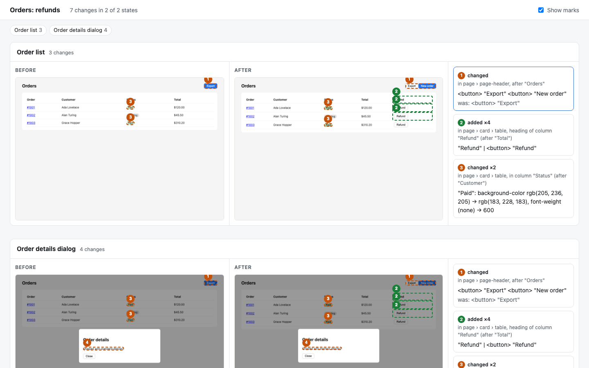

# redlines

**See what a UI change does, state by state.**

Code has diffs, APIs have contracts, data has schemas. A change to how a page *looks and behaves* has nothing you can review: a JSX diff doesn't show the page, and a screenshot pasted in a PR shows one state of it. Now that designers, PMs and AI agents change UIs straight in code, often nobody looks at the page at all before it ships.

redlines opens your running app in each state you care about (a page, a dialog opened, a form filled in, an empty list), records what is on screen, and compares it with the same states before the change. You get a list of what changed, element by element, and a review page with before and after side by side and every change boxed and numbered on both.

```
1. changed in page › page-header, after "Orders": <button> "Export" <button> "New order"  (was: <button> "Export")
2. added ×4 in page › card › table, heading of column "Refund" (after "Total"): "Refund" | <button> "Refund"
3. changed ×2 in page › card › table, in column "Status" (after "Customer"): "Paid": background-color rgb(205, 236, 205) → rgb(183, 228, 183), font-weight (none) → 600
```



Try it on the example app in this repo: `npm install && npm run demo` (it writes `.redlines/demo/`).

It is not pixel diffing. redlines reads the rendered page: elements, text, the styles that make them look the way they do, and in React apps the component each element comes from and its props (`<Badge tone="success">`). So it can tell you *what* changed and *where*, in words, and ignore what moved only because something above it grew.

## Quick start

Install it from GitHub (it builds itself on install; `#v0.3.0` pins a release, `#main` follows the latest):

```bash
npm install --save-dev github:jinjin99/redlines#v0.3.0
npx playwright-core install chromium   # if you don't have a Chromium from Playwright already
```

Or run it without installing: `npx -y github:jinjin99/redlines#v0.3.0 <tool> …`.

Describe the states to look at in `redlines.config.mjs`:

```js
export default {
    viewport: { width: 1280, height: 800 },
    // Answer API requests with fixed data, so both versions show the same thing.
    mocks: {
        'GET /api/orders': [{ id: '#1001', customer: 'Ada Lovelace', status: 'Paid', total: '$120.00' }],
    },
    states: {
        list: { path: '/orders', title: 'Order list' },
        details: { path: '/orders', title: 'Order details', steps: [{ click: 'text=#1001' }] },
        empty: { path: '/orders', title: 'No orders yet', mocks: { 'GET /api/orders': [] } },
    },
};
```

Capture the app before and after the change, then compare:

```bash
npx redlines capture_states --base http://localhost:3000 --out .redlines/before   # on main
npx redlines capture_states --base http://localhost:3001 --out .redlines/after    # on your branch
npx redlines find_changes --before .redlines/before --after .redlines/after
npx redlines create_review --before .redlines/before --after .redlines/after
open .redlines/review/index.html
```

The review page is a folder of static files: open it locally, or put it on any static host and link it from the PR.

## Tools

The same tools, by the same names and inputs, on the command line (`redlines <tool> --<input> <value>`) and over MCP. Arrays and objects are given as JSON on the command line (`--steps '[{"click":"text=Save"}]'`), a boolean as a bare flag (`--fullPage`). `redlines help` lists them with their inputs.

| Tool | What it does |
| --- | --- |
| `data_proxy --action start\|stop\|status [--mode record\|replay] [--out <file>] [--port <n>]` | Records or replays the requests a server-rendering app makes on the server. See [the data proxy](#server-side-requests-the-data-proxy). |
| `record_data --base <url> [--out <file>] [--states <names>]` | Records the API answers each state fetches from a real backend into a HAR file, to replay on later captures. See [Mock data](#mock-data). |
| `log_in --url <url> [--until <selector>] [--timeoutMinutes <n>]` | For an app behind a login: opens a browser window on the app for **you** to log in, waits until you have, and keeps the login for that app. See [Apps behind a login](#apps-behind-a-login). |
| `view_page --url <url> [--steps <json>] [--mocks <json>] [--width] [--height] [--fullPage]` | Opens a page of the running app (doing the steps first) and returns a screenshot, an outline of what is on screen and any page errors. Writes nothing (on the command line, the screenshot goes to `.redlines/view_page.png`). |
| `list_states [--config <file>]` | The states the project's config lists, or how to write the config. |
| `capture_states --base <url> --out <dir> [--states <names>] [--config <file>]` | Opens each state at `base`, does its steps, waits for it to settle, and writes `<state>.json` (the page tree), `<state>.png` (a full-page screenshot) and `<state>.html` (the page frozen as standalone HTML) into `out`, with a `manifest.json`. |
| `find_changes --before <dir> --after <dir> [--json]` | The changes between two captured folders, state by state. `--json` adds each change's boxes on the page. |
| `create_review --before <dir> --after <dir> [--out <dir>] [--title <text>]` | The review page: `index.html`, the screenshots and `changes.json` (default `.redlines/review`). |
| `export_design --from <dir> [--out <dir>] [--format dc\|html] [--title <text>]` | The states as editable design files. `dc`: a [Claude Design](https://claude.ai) canvas, one artboard per state. `html`: each state as one standalone HTML file (styles inlined, scripts out), to open and edit anywhere. Both link the states where a click leads, so the pages click through (Play on the canvas). See [Designing with it](#designing-with-it). |
| `find_design_edits --edited <dir> [--exported <dir>] [--json]` | What a designer changed on an exported canvas: the artboards as exported (default `.redlines/design`) against the same files read back after they edited them, as the same list of changes `find_changes` gives. Artboards they added come with an outline. |

Every path a tool reads or writes is inside the project folder (the current directory, or `REDLINES_ROOT`).

## Mock data

The same data on both versions is what makes a comparison mean anything, so redlines answers the page's requests itself, without touching the app: no code in it, no service worker, nothing to start. Requests nothing answers go to the network as usual. `.redlines/` gets a `.gitignore` of its own the first time redlines writes there: captures, recordings (real backend data) and logins stay out of git unless you delete it.

Three sources, tried in this order (the first with an answer wins):

1. **`mocks` in the config**: `{ "GET /api/orders": [...] }`. For a few endpoints, or to pin one state's data.
2. **Your MSW handlers**: if the project already mocks with [MSW](https://mswjs.io) (2.4 or later), point at the module:

   ```js
   msw: './src/mocks/handlers.ts',           // its `handlers` export; or { file, export: 'name' }
   states: {
       list: { path: '/orders' },
       empty: { path: '/orders', msw: 'emptyOrders' },   // another list the module exports, used first
   },
   ```

   The path is relative to the config file, so the handlers can live outside the app's repository. Handlers in TypeScript load on Node 22.18 or later; on Node 20, point at compiled JavaScript.
3. **A recording**: for an app with a real backend and too many endpoints to mock, record what it fetches once, then replay it:

   ```bash
   npx redlines log_in --url http://localhost:3000            # if the app needs it
   npx redlines record_data --base http://localhost:3000      # writes .redlines/recording.har
   ```

   ```js
   recording: '.redlines/recording.har',
   ```

   `record_data` opens every state against the real backend, with no mocks, and keeps the API answers the pages fetch: fetch and XHR only, never scripts or styles (those must come from the version being captured), no request headers, and of the response only its body and content type. Recording again adds to the file. Replay matches a request by method, path and query (any host, so a different dev server port works) and body, falling back to method and path. The file is the backend's real data: keep it out of public repositories.

All three answer requests the **browser** makes. An app that renders on the server (Next.js, Remix, TanStack Start, an SSR dev server) fetches its first screen's data on the server, where they can't reach: the data is already in the HTML the browser gets. For that, there is the data proxy.

### Server-side requests: the data proxy

The dev server is started with proxy variables, so its own requests to the backend go through a local proxy redlines runs. Recording, the proxy passes them on and keeps the answers; replaying, it answers from them. It reads and writes the same recording file as `record_data`, so one file holds the server's requests and the browser's.

```bash
npm install --save-dev mockttp                          # the proxy's engine, an optional dependency
npx redlines data_proxy --action start --mode record    # prints the variables for the dev server
HTTP_PROXY=… HTTPS_PROXY=… NODE_USE_ENV_PROXY=1 NODE_EXTRA_CA_CERTS=… npm run dev
npx redlines record_data --base http://localhost:3000   # the browser side, into the same file
npx redlines data_proxy --action stop                   # saves the recording
```

Then the same with `--mode replay`, and `recording` set in the config, for every capture after. `data_proxy --action stop` says how many requests were answered from the recording and how many passed on to the backend (with a list of the ones the recording lacks in `.redlines/data-proxy.log`), so a replay that quietly went to the backend shows.

HTTPS is read by acting as the backend towards the dev server, with a certificate from a certificate authority made for this proxy alone (`.redlines/proxy-ca/`, the key readable only by you), which only that dev server is told to trust, through `NODE_EXTRA_CA_CERTS`. Nothing is installed system-wide, and the browser is not involved. Node sends its own `fetch` and `http` through the variables from 22.21 / 24.5 on (`NODE_USE_ENV_PROXY`); clients such as axios read `HTTP(S)_PROXY` themselves. `localhost` is left out, so the dev server's calls to itself are untouched.

Without the proxy, capture both versions against the same backend close together in time, with `now` set: on a quiet test backend, two captures in a row come out the same.

### What a project provides

redlines needs nothing in the app's code. A project, or a separate repository next to it, provides:

- a `redlines.config.mjs`: the states to capture, and where their data comes from;
- the data: inline `mocks`, an MSW handlers module, a recording, or any mix of them.

`list_states` (and its MCP tool) reads the config back, so an agent setting up a new project sees what is there and what is missing.

## Apps behind a login

redlines never asks for a password. You log in yourself, once per app:

```bash
npx redlines log_in --url http://localhost:3000
```

A browser window opens on the app; log in as you always do. Once the window is back on the app (or `--until <selector>` shows), the browser's login state (cookies, local storage) is saved to `.redlines/auth/<host>.json` and the window closes. From then on `view_page` and `capture_states` open that app logged in. The file is a credential: it is readable only by you, and its folder carries its own `.gitignore`. Each host and port is separate, so the version before the change and the one after it each need a login. When it expires, a capture says the app sent the page to its login page; log in again.

In CI, where nobody can type, log in with steps and take the secret from the environment, never the config:

```js
login: { path: '/login', steps: [{ fill: ['#email', { env: 'APP_USER' }] }, { fill: ['#password', { env: 'APP_PASSWORD' }] }, { click: 'text=Log in' }] }
```

Error messages name the variable, never its value. For apps that decide in the browser whether you are logged in (they ask an API who you are), a mock of that API is often enough: `mocks: { 'GET /api/me': { id: 'u1', name: 'Designer' } }`.

## Designing with it

The same captures make a design to work on: a requirement drafted in the real code, a canvas a designer edits and plays through, and their edits read back into the code.

1. **Draft.** An agent changes the code for the requirement on a branch, lists the new screens and states in the config, captures them and exports a canvas (`export_design`). The `draft_design` prompt (MCP, or `redlines prompt draft_design --requirement "…"`) walks it through every step.
2. **Play.** Where a click leads from one state to another, the export puts a see-through link over the element: Play on the canvas (or clicking through the HTML pages) walks the flow. A state whose steps continue another's on the same page is linked from it by itself (the list's `#1001` leads to the details dialog); other ways, like Back or a link to another page, are the state's `links`:

   ```js
   details: { path: '/orders', steps: [{ click: 'text=#1001' }], links: { '#close': 'list' } },
   ```

3. **Edit.** The designer edits the canvas: copy, spacing, colours, new artboards, comments.
4. **Back to code.** Read the edited artboards into a folder in the project (same file names) and `find_design_edits --edited <folder>` lists each edit against the export: where it is, what it says now and before, styles property by property. The agent carries them into the code, through the project's components and tokens, then captures and exports again; the canvas then shows the code, edits included. Text that came from the page's data (an API answer: a customer's name, a product title) is marked `! not code`, with the request and key it came from: that edit belongs in the data or configuration, not the code.

The baseline for the designer's edits is the export itself (`.redlines/design`), so nothing else is stored: no database, no server. Exporting again makes the new export the baseline.

## For coding agents (MCP)

`redlines mcp` serves the same tools over stdio, with instructions telling the agent when to use them: `view_page` on every page it changed before saying it is done; to show a change, capture the app before (main branch) and after (its working copy), find the changes, and hand over the review page. Its `draft_design` prompt walks a requirement from code to a canvas a designer edits, and back.

```bash
claude mcp add redlines -- npx -y github:jinjin99/redlines#v0.3.0 mcp
# other MCP clients: command "npx", args ["-y", "github:jinjin99/redlines#v0.3.0", "mcp"]
```

Run it from the project folder.

## Config

The config is checked when it is read: a key redlines doesn't know is an error naming the key it most likely meant (`states.list.step: unknown key (did you mean steps?)`), and every problem is listed at once, rather than a misspelt option quietly doing nothing.

| Key | |
| --- | --- |
| `baseURL` | Where the app runs. `--base` overrides it, so one config captures both versions. |
| `viewport` | `{ width, height }`, default 1280 × 800. A state can set its own. |
| `states` | `{ <name>: { path, title, steps, mocks, viewport, settle, ignore, links } }`. Names are letters, digits, `-` and `_`. |
| `links` | Per state, `{ <selector>: <state> }`: where clicking that element leads, for the exported pages and canvas to play through. A state whose steps continue another's on the same page needs none. |
| `steps` | Done in order after the page loads: `{ click: <selector> }`, `{ fill: [<selector>, <text> or { env: <variable> }] }`, `{ press: <key> }`, `{ hover: <selector> }`, `{ select: [<selector>, <value>] }`, `{ waitFor: <selector> }`, `{ wait: <ms> }`, or a function `async page => …` (Playwright's page). Selectors are [Playwright selectors](https://playwright.dev/docs/locators): `text=Save`, `role=button[name="Save"]`, CSS. |
| `mocks` | `{ "<METHOD> <path>": <answer> }`, for every state, and per state on top. The path is matched from the start, `*` matches anything. An answer is JSON data, `{ status, json \| body, headers }`, or a function of the request. Requests not listed go to the network. |
| `ignore` | A CSS selector for parts of the page to leave out (a clock, an ad slot). |
| `settle` | Milliseconds to wait after the page is idle, default 300. |
| `stepTimeout` | How long a step waits for what it acts on, default 5000 ms. A step that finds nothing fails the state with which step and why. |
| `locale`, `timezone` | Default `en-US` and `UTC`, so dates read the same on every machine. |
| `now` | The time pages see as now, e.g. `'2026-11-03T10:00:00Z'`. Pages that work dates out from today ("the last 30 days") then read the same whenever they are captured, so the version before a change, captured yesterday, and the one after it, captured today, don't differ only by the date. |

Animations and transitions are turned off and the caret hidden while capturing, so two shots of the same page are the same.

## What it records

`<state>.json` is the page tree:

```js
{
  version: 1, url, title,
  viewport: { width, height }, size: { width, height },   // size: the whole page
  state: { name, title, path },
  root: {
    tag: 'body',
    name: 'page',                                          // what a person calls it: aria-label, component, readable class, landmark
    component: { name: 'Badge', props: { tone: 'info' } }, // React only: the component whose whole output this element is
    classes: ['badge'],                                    // readable ones only, not build hashes
    attrs: { href, src, alt, role, 'aria-label', value, … },
    style: { color, 'background-color', 'font-size', padding-*, gap, … },
    box: [x, y, width, height],                            // page pixels
    children: [ …elements, { text: 'Paid', box: [x, y, w, h] } ]
  }
}
```

`capture_states` also freezes each state as `<state>.html`: the page as rendered, with every stylesheet it could read inlined, same-origin images as data URLs, and no scripts. It is opened again and compared with the screenshot pixel by pixel; the share that matches is `fidelity` in `manifest.json`. That file is what `export_design` builds on.

Only what is on screen is in the page tree: hidden elements, screen-reader-only text and invisible measuring copies are left out, since changing them changes nothing anyone sees.

`changes.json` (from `create_review`, or `find_changes --json`) lists, per state, each change: `kind` (`added`, `removed`, `changed`), `where` (the named elements it is in and the text just before it), `now` and `was` (what it holds: components, interactive elements and text), `styles` (for a restyle: each property, before and after), `count` (one change repeated, like a cell in every row) and `boxes.before` / `boxes.after` (where it is on each page).

## How changes are found

Each tree is read into a sequence (an element opening, its text, its closing), the two sequences are aligned (longest common subsequence), and each run that differs becomes a change. A few rules make the list read like a person would describe it:

- A run is moved to where it is whole elements, so an added button isn't reported as half of one button and half of the next.
- Content wrapped in a new element, and edits a few tokens apart in one place, are one change.
- In a table, changes are grouped by column: a new column is one change, not one per row.
- Inherited styles (color, font) count where they are set, not again on every child.
- Boxes are not compared: a page that only moved down is not a change.

## Status

Early. What works today: capturing states of any web app with Playwright, mocked APIs, React component names and props, the change list, the review page, editable exports (HTML, Claude Design), and an MCP server for coding agents. Planned:

- More export targets for the editable states (Figma).
- A GitHub Action that captures both sides of a PR and comments with the review page.
- Reusing the mocks an app already has (MSW handlers).
- Presets for component libraries, to name changes in their terms.

## Developing

redlines is written in TypeScript (`src/`, `bin/`), built with `tsc` into `dist/`, and needs Node 20 or later. CI lints, builds and tests it on Node 20, 22 and 24 on Linux, and on macOS and Windows.

```bash
npm install
npm run lint    # ESLint
npm test        # builds, then runs the tests (they drive a real Chromium)
npm run demo    # the example app, captured before and after, into .redlines/demo/
```

`src/page/` holds the functions that run inside the page (Playwright sends their source there), so they import nothing at run time and must stay self-contained.

## License

MIT
